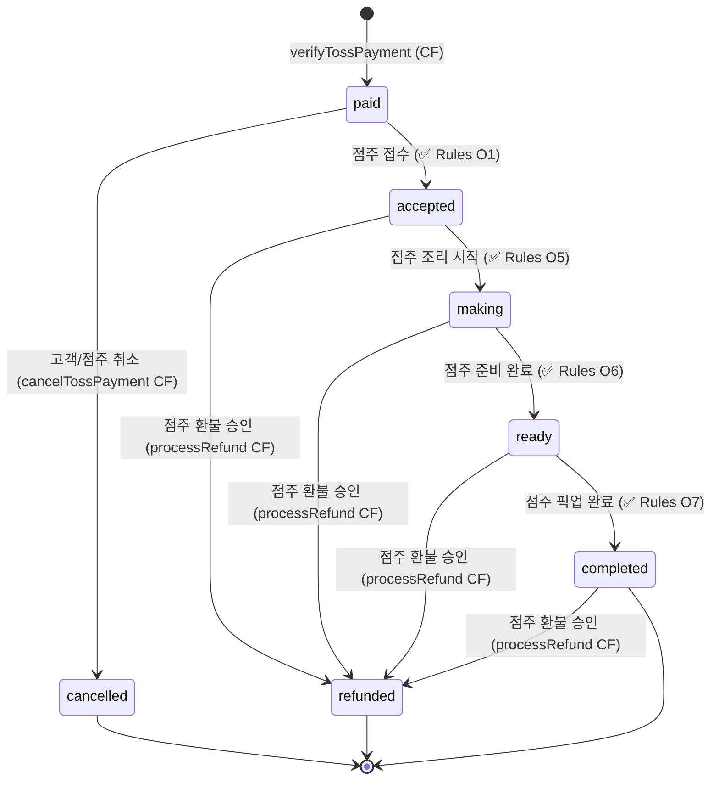
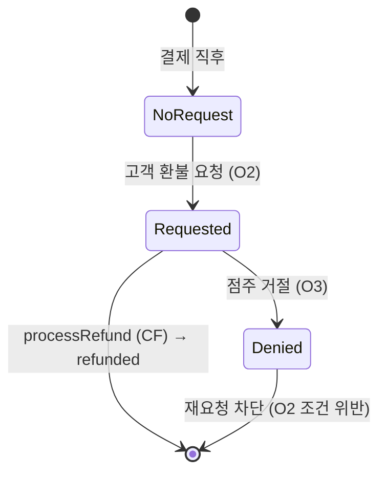
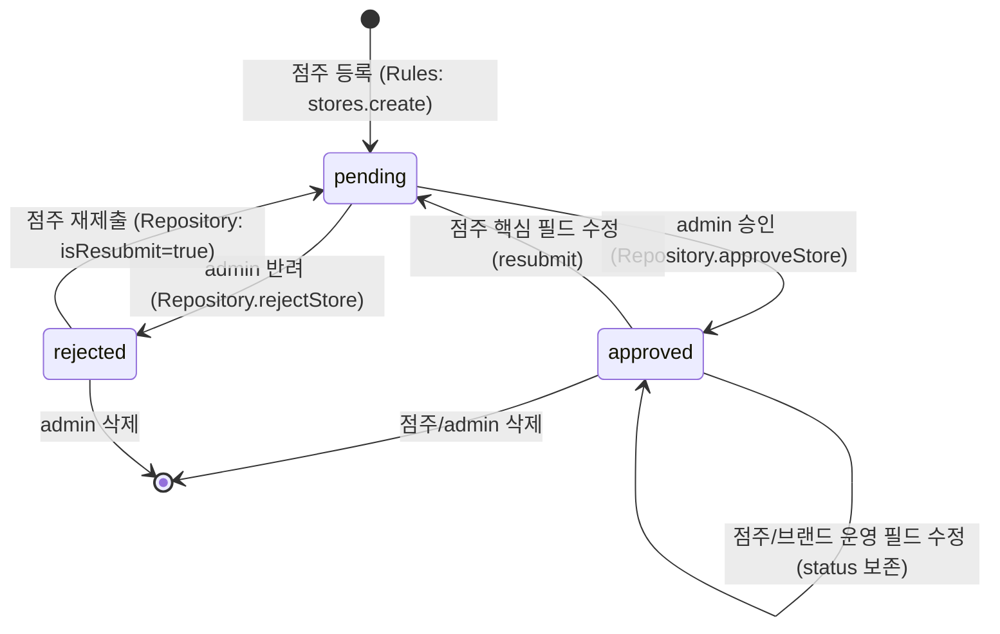
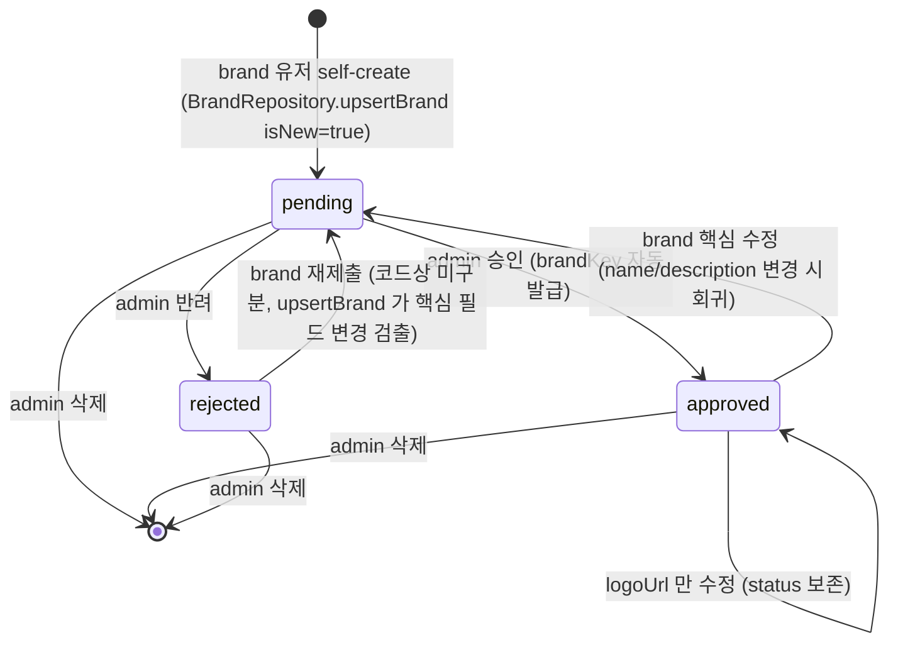
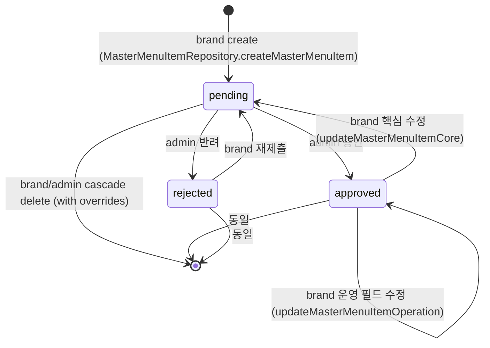
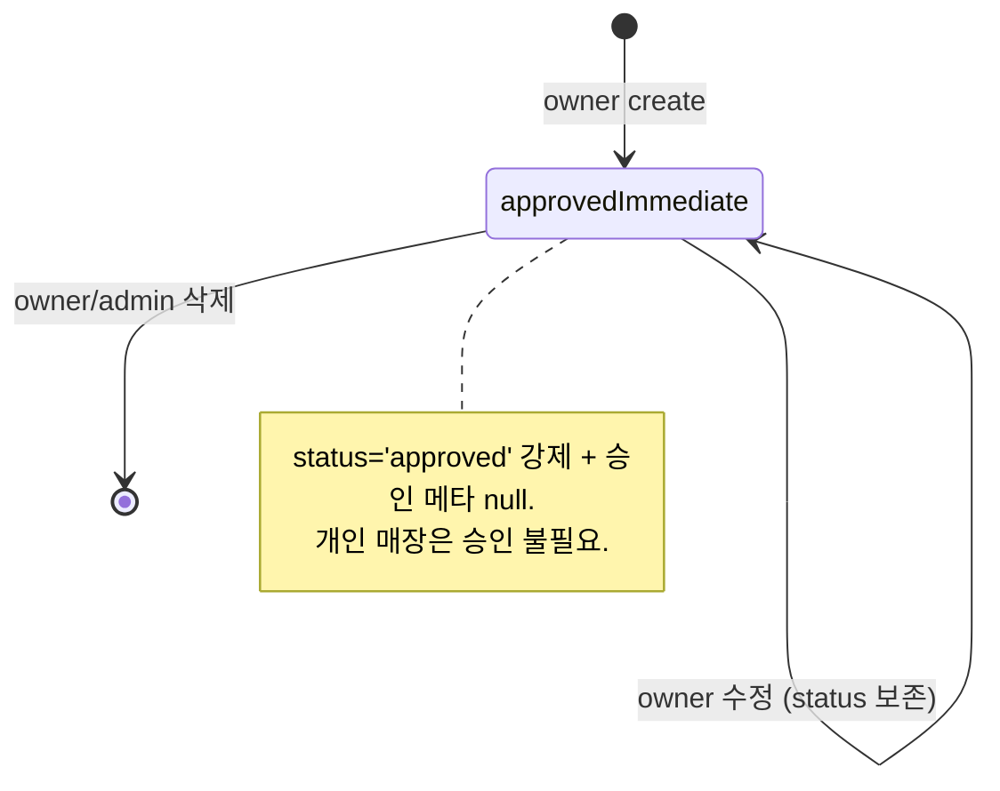
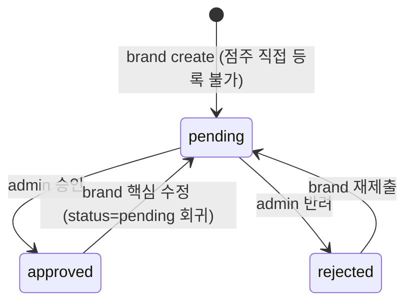
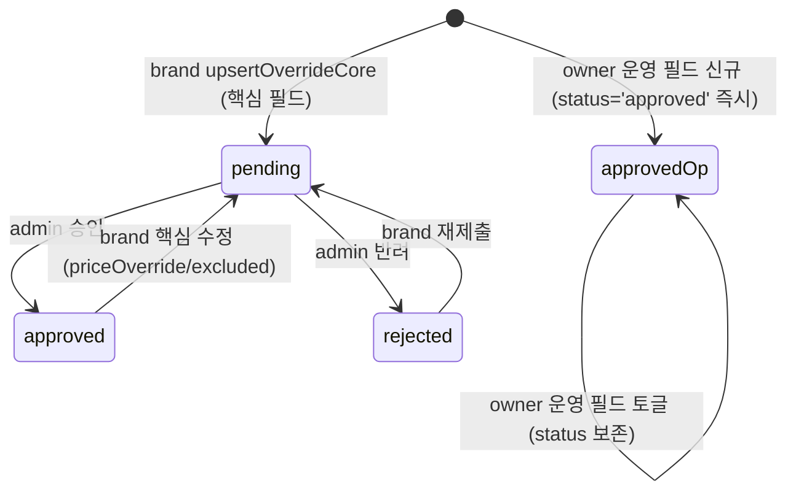

# Qradar Entity Lifecycle

이 문서는 Qradar 주요 엔티티의 **status 전이 다이어그램**과 각 전이의 **actor(주체) / 조건 / 갱신 필드 / Security Rules 분기**를 정리한다.

**목적**: 신규 기능에서 status 를 변경할 때, 누가 어떤 조건에서 어디로 갈 수 있는지를 즉시 확인.

**범위 분리**:
- 컬렉션별 데이터 접근 권한 매트릭스 → [`data_ownership.md`](./data_ownership.md)
- 역할별 진입점 / 액션 카탈로그 → [`role_flows.md`](./role_flows.md)

---

## 1. 다루는 엔티티

| 엔티티 | status enum | 위치 |
|---|---|---|
| Order | `OrderStatus` (paid/accepted/making/ready/completed/cancelled/refunded) | `orders/{orderId}` |
| Store | `EntityApprovalStatus` (pending/approved/rejected) | `stores/{storeId}` |
| Brand | `EntityApprovalStatus` | `brands/{brandId}` |
| MasterMenuItem (브랜드 마스터) | `EntityApprovalStatus` | `brands/{brandId}/menuItems/{id}` |
| StoreOnlyMenuItem (점포 한정) | `EntityApprovalStatus?` (개인 매장은 null, 브랜드 매장은 pending) | `stores/{storeId}/menuItems/{id}` |
| MenuOverride (가맹점 오버라이드) | `EntityApprovalStatus` | `stores/{storeId}/menuOverrides/{masterMenuItemId}` |
| RefundRequest (Order 내부 sub-doc) | (deniedAt null vs not-null) | `orders/{orderId}.refundRequest` |

**공통 표기**:
- "✅ Rules" — `firestore.rules` 가 명시적으로 허용/검증
- "🛠 CF" — Cloud Function 만 가능 (Admin SDK)
- "🔒 클라이언트 차단" — `allow X: if false` 또는 명시적 거부

---

## 2. Order Lifecycle

### 2.1 다이어그램

### 2.2 전이 상세

| 전이 | actor | 메커니즘 | 조건 | 갱신 필드 | Rules 분기 |
|---|---|---|---|---|---|
| (없음) → paid | Cloud Function `verifyTossPayment` | 🛠 CF (Admin SDK) | Toss confirm 응답 검증 통과 + 동일 orderId doc 미존재 | 전체 doc create (status='paid', items, paymentInfo, createdAt, updatedAt 등) + `users/{uid}/orderLogs/{logId}` 동시 생성 | `orders.create: if false` (클라이언트 차단). CF 만 Admin SDK 로 우회 |
| paid → accepted | owner | ✅ Rules `isOwnerAcceptUpdate` | `isStoreOwner(storeId)` + `resource.status=='paid'` | `status='accepted'`, `acceptedAt`, `updatedAt` (이외 변경 차단) | `orders.update` O1 분기 |
| accepted → making | owner | ✅ Rules `isOwnerStartMakingUpdate` | `isStoreOwner(storeId)` + `resource.status=='accepted'` | `status='making'`, `makingStartedAt`, `updatedAt` | `orders.update` O5 분기 |
| making → ready | owner | ✅ Rules `isOwnerMarkReadyUpdate` | `isStoreOwner(storeId)` + `resource.status=='making'` | `status='ready'`, `readyAt`, `updatedAt` | `orders.update` O6 분기 |
| ready → completed | owner | ✅ Rules `isOwnerCompletePickupUpdate` | `isStoreOwner(storeId)` + `resource.status=='ready'` | `status='completed'`, `completedAt`, `updatedAt` | `orders.update` O7 분기. **후속 액션**: 이 전이 이후 고객이 해당 매장을 평가할 수 있다 (`completedAt` 기준 14일, UI 강제). 상세는 `docs/tasks/store_reviews/` |
| paid → cancelled (고객 취소) | customer | 🛠 CF `cancelTossPayment` (approvedBy='customer') | `order.userId == uid` + `order.status=='paid'` | `status='cancelled'`, `cancelInfo`, `cancelledAt`, `updatedAt` | 클라이언트 직접 update 차단. CF 가 권한·status 재검증 후 update |
| paid → cancelled (점주 거절) | owner | 🛠 CF `cancelTossPayment` (approvedBy='owner') | `stores/{storeId}.ownerId == uid` + `order.status=='paid'` | 동일 | 동일 |
| accepted+ → refunded | owner | 🛠 CF `processRefund` | `stores/{storeId}.ownerId == uid` + `order.refundRequest != null` + `order.status ∈ {accepted, making, ready, completed}` | `status='refunded'`, `refundInfo` (cancellationKey, reason, approvedBy=uid, processedAt, amount), `refundedAt`, `updatedAt` | 클라이언트 update 차단. CF 만 |
| paid/accepted+ → cancelled/refunded (admin 전권) | admin | ✅ Rules O4 (`isAdmin()`) | — | 임의 필드 update 가능 | `orders.update` O4 |

### 2.3 Order 내부 sub-state: refundRequest

`orders/{orderId}.refundRequest` 는 자체 status 가 아니라 **존재 여부 + deniedAt** 으로 분기.

| 전이 | actor | 메커니즘 | 조건 | 갱신 필드 | Rules 분기 |
|---|---|---|---|---|---|
| (없음) → Requested | customer | ✅ Rules `isCustomerRefundRequest` (O2) | `order.userId == uid` + `order.status == 'accepted'` (결정 F: making/ready/completed 차단) + `refundRequest == null` (또는 `deniedAt == null`) | `refundRequest={reason, requestedAt}`, `updatedAt`. **refundRequest 내부 reason/requestedAt 만 허용**. | `orders.update` O2 |
| Requested → Denied | owner | ✅ Rules `isOwnerDenyRefund` (O3) | `isStoreOwner(storeId)` + `refundRequest != null` + `deniedAt == null` | `refundRequest` 에 `deniedAt`, `deniedReason` 추가. 내부 필드 4개(`reason`, `requestedAt`, `deniedAt`, `deniedReason`)만 허용. | `orders.update` O3 |
| Requested → (사라짐, processRefund) | owner | 🛠 CF `processRefund` | (위 refunded 전이와 동일) | order doc 전체가 refunded 로 전이됨. `refundRequest` 는 그대로 남아있음 (이력) | — |

**결정 F (Phase 3c)**: 고객 환불 요청은 `accepted` 상태일 때만 허용. `making`/`ready`/`completed` 상태에서는 Rules(O2) + UI(U7 안내 카드) 양측에서 차단. 카페 픽업 도메인에서 조리 시작 후 환불은 표준적으로 불가.

**주의**: O2 의 "재요청 차단" 은 `deniedAt != null` 인 경우만 막는다. 한번 거절당하면 영구히 재요청 불가. **확인 필요** — UX 적으로 "다시 환불 요청" 이 가능해야 하는지 검토.

### 2.4 코드 진입점

| 전이 | 호출 경로 |
|---|---|
| paid 생성 | `presentation/customer/checkout/checkout_page.dart` → `verify_and_create_order_use_case` → `payment_gateway_repository_impl.verifyAndCreateOrder` → CF |
| paid → accepted | `presentation/owner/orders/owner_orders_page.dart` → `order_repository_impl.setAcceptedByOwner` (직접 Firestore update) |
| paid → cancelled (고객) | `presentation/customer/checkout/payment_result_page.dart` 또는 주문 상세 → `payment_gateway_repository_impl.cancelPaidOrder` (approvedBy='customer') |
| paid → cancelled (점주) | `presentation/owner/orders/**` → `cancelPaidOrder` (approvedBy='owner') |
| refund 요청 | `presentation/customer/order/**` → `order_repository_impl.requestRefund` |
| refund 거절 | `presentation/owner/orders/**` → `order_repository_impl.denyRefundRequest` |
| refund 승인 (전액) | `presentation/owner/orders/**` → `payment_gateway_repository_impl.processRefund` |

### 2.5 보류/미구현

- **making / ready / completed 전이 구현 완료 (Phase 3c)**: Security Rules O5/O6/O7 분기 추가. `StartMakingOrderUseCase` / `MarkOrderReadyUseCase` / `MarkOrderCompletedUseCase` 및 점주 UI(`OwnerOrdersPage` 3탭 + `OwnerInProgressOrderTile` + 픽업 완료 다이얼로그) 구현. `OwnerOrderDetailPage` 에 `_TimelineSection` 노출.
- **ready → completed 옵트인 알림 (Phase 3c-3)**: `onOrderStatusChanged` 가 `users/{userId}.notificationSettings.pickupComplete == true` 일 때만 고객에게 `order_completed` 알림 발송 (기본 false → 미발화). 전이 조건·actor 는 불변.
- **부분 환불 미구현**: `processRefund` 가 항상 전액 환불.
- **재환불 요청 차단** (위 2.3 주의 참조).

---

## 3. Store Lifecycle

### 3.1 다이어그램

### 3.2 전이 상세

| 전이 | actor | 메커니즘 | 조건 | 갱신 필드 | Rules 분기 |
|---|---|---|---|---|---|
| (없음) → pending | owner | ✅ Rules `stores.create` | `isOwner()` + `ownerId == uid` + `status == 'pending'` | 전체 doc create. `submittedBy=uid`, `submittedAt=now`, `brandId` (brandKey 매칭 시) | `stores.create` |
| pending → approved | admin | ✅ Rules `stores.update` (admin 전권) | `_assertAdmin()` (StoreRepository) | `status='approved'`, `approvedBy=adminUid`, `approvedAt`, `rejectedReason=null`, `updatedAt` | admin 분기 |
| pending → rejected | admin | 동일 | 동일 | `status='rejected'`, `approvedBy=adminUid`, `rejectedReason`, `updatedAt` | admin 분기 |
| rejected → pending (재제출) | owner | ✅ Rules `isStoreOwnerFieldUpdate` | `isStoreOwner(storeId)` + 핵심 필드(name, menuCategories, address 등) 수정 | `status='pending'`, `submittedBy=uid` 갱신, `approvedBy/approvedAt/rejectedReason` 클리어 (`updatedAt`) | owner update — 단, Rules `onlyChangedFields` 에 `status` 미포함이므로 **현재 형태로는 차단됨** ⚠️ **확인 필요** |
| approved → pending (점주 핵심 수정) | owner | 동일 | 동일 | `status='pending'`, `submittedBy/submittedAt` 갱신 | 동일 ⚠️ **같은 이슈** |
| approved → approved (운영 필드만) | owner | ✅ Rules `isStoreOwnerFieldUpdate` | `isStoreOwner(storeId)` + name/imageUrl/phone/address 등 운영 필드만 변경 | 해당 필드 + `updatedAt` | Rules 통과 |
| approved → approved (브랜드 운영 필드) | brand (가맹점주가 아닌 본사) | ✅ Rules `isStoreOwnerBrandUpdate` | `isBrandHolder(store.brandId)` + 운영 필드만 변경 | 동일 | Rules 통과 |
| 모든 status → 삭제 | owner / admin | ✅ Rules `stores.delete` | `isAdmin() || isStoreOwner(storeId)` | doc delete | delete |

### 3.3 불일치 (재설계 후보)

**핵심 문제**: `StoreRepositoryImpl.updateStoreCoreFields` 는 status 를 pending 으로 회귀시킴 (`isResubmit` 로직). 하지만 Security Rules `isStoreOwnerFieldUpdate` 의 `onlyChangedFields` 화이트리스트는 **`status`, `submittedBy`, `submittedAt`, `approvedBy`, `approvedAt`, `rejectedReason` 을 포함하지 않음**.

- 코드: status='pending', approvedBy=null, ... 으로 update 시도
- Rules: 화이트리스트에 없는 필드 변경 → 차단

**확인 필요**: 실제 운영에서 점주 핵심 필드 수정이 어떻게 통과하는지 (또는 통과하지 못해 silently fail 인지). 가능성:
1. 실제로 차단되어 점주는 핵심 필드 수정 불가
2. admin 만 핵심 필드 수정 가능 (의도된 정책이지만 UI 와 불일치)
3. Rules 화이트리스트에 승인 메타 필드를 추가해야 함

이는 spec.md 누락이 만들었던 클래스의 버그 패턴 — 코드와 Rules 가 따로 진화함.

### 3.4 코드 진입점

| 전이 | 호출 경로 |
|---|---|
| 등록 (pending) | `owner/my_store/store_core_form_page.dart` → `submit_store_for_approval_use_case` → `store_repository_impl.submitStoreForApproval` |
| 점주 핵심 수정 | 동일 폼 (existing != null) → `updateStoreCoreFields` |
| 점주 운영 필드 | `owner/my_store/**` → `updateStoreOperationFields` |
| admin 승인/반려 | `admin/approval/admin_store_approval_detail_page.dart` → `approveStore` / `rejectStore` |
| 브랜드(본사) 가맹점 운영 필드 | `brand/stores/**` → (확인 필요 — repository 호출 명확치 않음) |

---

## 4. Brand Lifecycle

### 4.1 다이어그램

### 4.2 전이 상세

| 전이 | actor | 메커니즘 | 조건 | 갱신 필드 | Rules 분기 |
|---|---|---|---|---|---|
| (없음) → pending | brand 유저 | ✅ Rules `brands.create` | `isBrand()` + `submittedBy == uid` + `status == 'pending'` + `brandKey == ''` | brand doc 전체 create + batch 로 `users/{uid}.brandId=brandId` 동시 set | `brands.create` |
| pending → approved | admin | ✅ Rules `brands.update` (admin 전권) | (admin) | `status='approved'`, `approvedBy=adminUid`, `approvedAt`, `brandKey`(자동 생성 `BR-XXXXXXXX`, unique 검증 최대 3회 retry), `rejectedReason=null`, `updatedAt` | admin 분기 |
| pending → rejected | admin | 동일 | (admin) | `status='rejected'`, `approvedBy`, `rejectedReason`, `updatedAt` | admin 분기 |
| approved → pending (핵심 수정) | brand 본인 | ✅ Rules `isBrandSelfUpdate` | `isBrandHolder(brandId)` + 변경 필드 화이트리스트 (name, description 등) | `status='pending'`, `submittedBy/submittedAt` 갱신, **`approvedBy/approvedAt` 보존** (수정 대기 라벨 구분용), `brandKey` 보존 (V1 불변성) | brand 분기 ⚠️ **Store 와 동일한 화이트리스트 이슈 가능성** |
| approved → approved (logoUrl만) | brand 본인 | 동일 | logoUrl 단독 변경 | `logoUrl`, `updatedAt` | brand 분기 |
| 모든 status → 삭제 | admin | ✅ Rules `brands.delete: if isAdmin()` | (admin) | doc delete | admin 분기 |

### 4.3 불일치 (재설계 후보)

**Rules 화이트리스트 vs 코드 갱신 필드 불일치**:
- Rules `isBrandSelfUpdate` 의 `onlyChangedFields`: `['name', 'imageUrl', 'description', 'phone', 'address', 'businessHours', 'updatedAt', 'tags', 'logoUrl']`
- `BrandRepositoryImpl.upsertBrand` 가 핵심 필드 변경 시 set 하는 필드: `status`, `submittedBy`, `submittedAt`, `updatedAt` 등 (전체 doc set with merge)
- Rules 가 화이트리스트에 없는 필드(status, submittedBy 등) 변경을 차단 → **현재 형태로는 brand 본인 재제출 차단됨** ⚠️ **확인 필요**

이것이 바로 task 의 동기인 "users.brandId 설정 시점이 코드 곳곳에 흩어져 있어 Rules 와 불일치" 의 한 사례.

### 4.4 코드 진입점

| 전이 | 호출 경로 |
|---|---|
| 등록 (pending) | `BrandScaffold` 자동 진입 → `brand/brand_info/brand_info_form_page.dart` → `upsertBrandUseCase` → `BrandRepositoryImpl.upsertBrand` (isNew=true → batch) |
| brand 본인 수정 | 동일 폼 (brand != null) → `upsertBrand` (isNew=false) — 핵심/운영 자동 분기 |
| admin 승인 | `admin/approval/admin_brand_approval_detail_page.dart` → `approveBrandUseCase` → `BrandRepositoryImpl.approveBrand` (brandKey 자동 발급) |
| admin 반려 | 동일 → `rejectBrandUseCase` → `rejectBrand` |

---

## 5. MenuItem Lifecycle (master / store / store-only 3종)

MenuItem 은 **3가지 변종** 이 있고 각각 lifecycle 이 다르다.

### 5.1 변종 구분

| 변종 | 경로 | scope | status |
|---|---|---|---|
| 마스터 메뉴 (브랜드 본사) | `brands/{brandId}/menuItems/{id}` | `brand` | `EntityApprovalStatus` 필수 |
| 점포 한정 메뉴 (개인 매장) | `stores/{storeId}/menuItems/{id}` | `store`, `brandId=null` | **null** (개인 매장은 승인 불필요) |
| 점포 한정 메뉴 (브랜드 매장) | `stores/{storeId}/menuItems/{id}` | `store`, `brandId=<brandId>` | `EntityApprovalStatus` 필수 |

머지 규칙: `MenuItemRepositoryImpl._mergeForBrandStore` — 가맹점 화면에는 `master(approved+visible)` + `storeOnly(approved+visible)` + `override(approved 시 핵심필드 적용, 운영필드는 status 무관)` 머지.

### 5.2 마스터 메뉴 (brand-scope)

| 전이 | actor | 갱신 | Rules 분기 |
|---|---|---|---|
| (없음) → pending | brand | scope='brand', brandId=myBrandId, status='pending', submittedBy=uid | `brands/{brandId}/menuItems.create`: `isAdmin() || isBrandHolder(brandId)` |
| pending → approved | admin | status, approvedBy, approvedAt, rejectedReason=null | 동일 — admin 통과 |
| pending → rejected | admin | status='rejected', rejectedReason | 동일 |
| approved → pending (핵심 수정) | brand | status='pending', submittedBy/At 갱신, **approvedBy/At 보존** (수정 대기 라벨 구분) | 동일 |
| approved → approved (운영) | brand | `visible`, `tags`, `displayOrder`, `imageUrl`, `updatedAt` 만 (status 무관) | 동일 |
| cascade delete | brand/admin | doc delete + `menuOverrides` 일괄 삭제 (collectionGroup) | 동일 |

**갈래**: bulk approve/reject 도 admin 전용 (`_assertAdminOnly`).

### 5.3 점포 한정 메뉴 — 개인 매장 (brandId=null)

| 전이 | actor | 메커니즘 | 갱신 |
|---|---|---|---|
| 생성 | owner (`_assertOwnerOfPersonalStore`) | `MenuItemRepositoryImpl.createStoreOnlyMenu` | `scope='store'`, `brandId=null`, `status='approved'`, `submittedBy/At/approvedBy/At/rejectedReason=null` |
| 수정 | owner | `updateStoreOnlyMenuCore` 또는 `updateStoreOnlyMenuOperation` | status='approved' 유지 |
| 삭제 | owner / admin | `deleteStoreOnlyMenu` | doc delete |

**옵션 그룹 ref 제약 (sub-phase 7 S2)**: 개인 매장 메뉴는 `optionGroupRefs.scope ∈ {master, store}` 만 허용. `brand` scope 차단.

### 5.4 점포 한정 메뉴 — 브랜드 매장 (brandId=<brandId>)

| 전이 | actor | 메커니즘 | 갱신 |
|---|---|---|---|
| 생성 | brand | `createStoreOnlyMenu` (role=='admin' || 'brand' 만 통과) | scope='store', brandId=storeBrandId, status='pending', submittedBy=uid |
| pending → approved | admin | `approveStoreOnlyMenu` | status, approvedBy, approvedAt |
| pending → rejected | admin | `rejectStoreOnlyMenu` | status, approvedBy, rejectedReason |
| approved → pending (핵심 수정) | brand | `updateStoreOnlyMenuCore` (brandId!=null 분기) | status='pending' 회귀 |

**Rules 분기**: `stores/{storeId}/menuItems` 는 admin / `isStoreOwner(storeId)` / `isBrandHolder(store.brandId)` 모두 허용. 즉 Rules 는 점주도 통과시키지만, Repository 가 role 검증으로 차단 — 점주는 브랜드 매장의 메뉴를 직접 생성할 수 없음. ⚠️ **방어 계층 일관성 부족** — Rules 단에서도 차단하는 게 안전.

### 5.5 MenuOverride (가맹점의 마스터 메뉴 오버라이드)

`stores/{storeId}/menuOverrides/{masterMenuItemId}` — 가맹점이 마스터 메뉴의 가격/제외/품절 등을 매장별로 덮어쓰는 doc.

| 전이 | actor | 메커니즘 | 갱신 |
|---|---|---|---|
| 핵심 필드 (priceOverride/excluded) 변경 | brand | `MenuOverrideRepository.upsertOverrideCore` | `status='pending'`, submittedBy, updatedBy='brand', updatedAt |
| pending → approved | admin | `approveOverride` | status, approvedBy, approvedAt, updatedBy='admin' |
| pending → rejected | admin | `rejectOverride` | status='rejected', rejectedReason, updatedBy='admin' |
| 운영 필드 (soldOut/disabledOption*) — override 없을 때 | owner (가맹점주) | `updateOverrideOperationFields` 첫 케이스 | doc 신규 set, status='approved' 즉시, priceOverride=null, excluded=false, updatedBy='owner' |
| 운영 필드 — override 있을 때 | owner | 동일 두번째 케이스 | partial update, status 보존 |

**머지 규칙**: customer 화면에 노출될 때
- 핵심 필드 (priceOverride / excluded) — `status==approved` 일 때만 적용
- 운영 필드 (soldOut / disabledOption*) — status 무관 즉시 적용

**Rules**: `stores/{storeId}/menuOverrides` create/update/delete 는 `admin || isStoreOwner(storeId) || isBrandHolder(store.brandId)` 모두 허용. 즉 점주가 핵심 필드(priceOverride/excluded) 도 직접 write 가능하다는 의미가 됨 — **확인 필요** 점주가 가격을 임의로 set 하는 게 차단되는지 (Repository `_assertBrandOwnership` 가 brand role 일 때만 검증).

---

## 6. RefundRequest (Order 내부 sub-doc, 재확인)

별도 컬렉션 아님. Order doc 내 `refundRequest` 필드. 상세는 [§2.3](#23-order-내부-sub-state-refundrequest) 참조.

요약:
- 생성 / 거절 / 환불 승인 모두 별도 actor / 메커니즘.
- 거절 후 재요청은 현재 차단됨 (확인 필요).

---

## 7. 상태별 검증 체크리스트 (신규 feature 추가 시)

신규 status 전이를 추가할 때 다음을 모두 충족해야 한다:

1. **누가 트리거하는가?** (customer/owner/brand/admin/CF 중 명확히)
2. **Security Rules 분기 추가** — actor 검증 + 이전 status 검증 + 변경 필드 화이트리스트 (`onlyChangedFields`)
3. **Repository 갱신 필드 목록** — Rules 화이트리스트와 정확히 일치 (코드/Rules drift 방지)
4. **승인 메타** (approvedBy, approvedAt, submittedBy, submittedAt, rejectedReason 등) 의 갱신/보존 정책 명시
5. **다른 doc 영향** (cascade delete, batch write 동기화 — 예: brand doc 생성 시 users.brandId)
6. **Cloud Function 필요 여부** — PG 호출, 외부 검증, 다중 collection batch 등은 CF 필수
7. **누락된 진입점이나 회복 경로가 없는지** (예: pending 으로 다시 못 가는 막다른 길)

---

## 8. 참조

- enum 정의:
  - [`lib/domain/entities/order_status.dart`](../../lib/domain/entities/order_status.dart)
  - [`lib/domain/entities/entity_approval_status.dart`](../../lib/domain/entities/entity_approval_status.dart)
  - [`lib/domain/entities/menu_item_scope.dart`](../../lib/domain/entities/menu_item_scope.dart)
- Repository 구현체: `lib/data/repositories/*.dart`
- Cloud Functions: `functions/src/{verifyTossPayment,cancelTossPayment,processRefund}.ts`
- Security Rules: [`firestore.rules`](../../firestore.rules)
