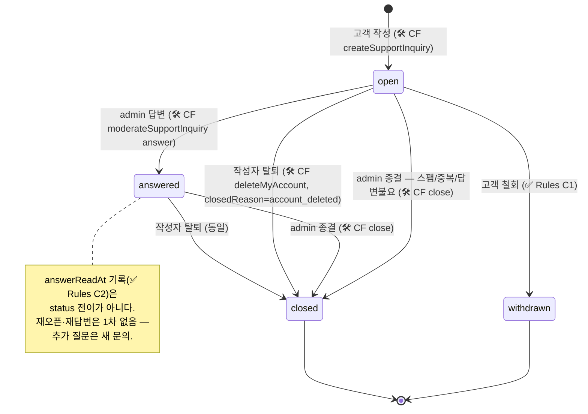

# support_inquiry (고객센터 문의 게시판) 기능 명세

## 개요

- **목적**:
  1. **랜딩 ↔ 앱 불일치 해소 (PG 심사 선행 조건).** `landing/index.html` 이 "앱 내 문의: Qradar 앱 → 내 정보 → 고객센터" 라고 안내하는데 **앱에 고객센터가 없다.** 고객 더보기(`lib/presentation/customer/more/more_page.dart`)에는 알림 설정 / 로그아웃 / 회원 탈퇴 / 버전 표기뿐이고, `kSupportContact`(`lib/core/constants/support_contact.dart`)가 노출되는 곳은 **점주·브랜드 탈퇴 차단 다이얼로그**(`more_page.dart:107`)와 **계정 정지 안내 화면**(`lib/presentation/common/account_suspended_view.dart:170`) 뿐이라 **일반 고객은 문의 경로를 볼 수 없다.**
  2. **식별 가능한 문의 채널 확보.** mailto 는 ① 기기 메일 계정이 없으면 열리지 않고 ② 가입 계정과 다른 주소로 보내면 **작성자를 특정할 수 없다.** `users.email` 은 nullable 이다(`lib/domain/entities/user_entity.dart` · 카카오 이메일 미동의) → **식별 수단으로 쓸 수 없다.** 로그인 상태에서 쓰는 게시판은 `uid` 가 자동으로 붙어 이 문제가 사라진다.
  3. **소비자 불만·분쟁 처리 기록의 법정 보존**(전자상거래법, 3년) 을 담을 그릇을 만든다.
- **작업 유형**: 신규 기능 (presentation 3화면 + domain + data + Cloud Function 2개 + Rules 1블록 + Storage Rules 1블록 + 어드민 콘솔 1섹션)
- **런칭 게이트**: **예.** 이 기능 완성 후 토스페이먼츠 **재신청**을 한다. 범위 확장을 하지 않는다 — §비범위를 지킨다.
- **핵심 설계 방향**:
  - **쓰기는 전부 서버 권위.** 생성·답변·종결은 Cloud Function 전담(`supportInquiries` 의 `create`/`delete` 는 Rules `if false`). 이유 3개: ① Rules 로는 "분당 1건" 같은 **도배 제한을 강제할 수 없다**(쿼리 불가) ② 첨부 URL 이 **작성자 자기 경로인지** 서버가 검증해야 한다 ③ 답변은 **append-only** 여야 한다(수정 허용 시 감사 추적이 깨진다 — `audit_trail.md §4-2`).
  - **고객의 쓰기 2개만 Rules 로 연다**: 답변 전 **철회**(`status: 'withdrawn'`), 답변 **읽음 표시**(`answerReadAt`). `orders` 의 O2(고객 환불 요청) 분기와 **같은 모양**(이전 status 검증 + `onlyChangedFields` 화이트리스트)이라 선례가 있고 CF 2개를 절약한다.
  - **삭제하지 않는다.** 고객 하드 삭제·내용 수정·답변 수정 모두 **1차에서 불허**. 분쟁 기록은 내용 자체가 증거이고 3년 보존 의무가 있다. 오타 교정은 **철회 후 재작성**으로 흡수한다.
  - **탈퇴해도 문의는 남는다.** `deleteMyAccount` 가 문의를 지우지 않고 **`authorDeleted` 마킹 + 열린 문의 종결**만 한다 (§7).
  - **주문 맥락은 박제한다.** `orderId` 참조만 두면 admin 이 주문을 삭제했을 때(`orders.delete: admin`) 맥락이 사라진다 → 생성 시 `orderSnapshot` 을 박제한다 (`audit_trail.md §4-3`).
- **영향 범위**:
  - **화면(앱)**: `customer/more/more_page.dart` 에 "고객센터" 진입 타일 추가(알림 설정 타일 바로 아래) · `customer/order/orders/order_detail_page.dart` 에 "이 주문 문의하기" 추가 · **신규 3화면** (`customer/support/` — 목록 / 작성 / 상세)
  - **Domain**: `SupportInquiryEntity`, `SupportInquiryAnswer`, `SupportInquiryCategory`(enum), `SupportInquiryStatus`(enum), `SupportInquiryOrderSnapshot`, `SupportInquiryRepository`(인터페이스), UseCase 6개, `SupportInquiryException`
  - **Data**: `SupportInquiryModel`, `SupportInquiryRemoteDataSource`, `SupportInquiryRepositoryImpl`, `StorageDataSource.uploadSupportInquiryImage` 메서드 추가
  - **Presentation**: DI providers + view providers + 신규 위젯 5개 (첨부 picker 포함)
  - **Firebase**: **신규 컬렉션 `supportInquiries`** · **신규 컬렉션 `supportInquiryLimits`**(rate limit 카운터) · **신규 CF `createSupportInquiry`**(self) · **신규 CF `moderateSupportInquiry`**(admin — 답변/종결) · `deleteMyAccount.ts` 에 phase 1단계 추가 · `firestore.rules` 2블록 · **`storage.rules` 1블록** · 복합 인덱스 3개
  - **공통 컴포넌트**: 더보기 진입 타일이 4개 `more_page` 에 private 복제돼 있다(`_NotificationSettingsTile` / `_Tile`) → **공통 승격 여부가 결정사항 Q9**
  - **라우팅**: `lib/app/router.dart` 는 **존재하지 않는다**(go_router 미사용). 전부 `Navigator.push(MaterialPageRoute)` + 생성자 인자 패턴
  - **권한 / 환경 설정**: Rules·Storage Rules 추가. 클라이언트 **쓰기 경로는 2개만**(철회·읽음). 하드코딩 설정값 없음
- **비범위 (1차 제외)**:
  - **답변 FCM 푸시 알림** → Phase 2 (기존 `onOrderStatusChanged` 인프라 재사용 가능). 1차의 재방문 신호는 **더보기 타일 미확인 dot**(§UI)로 대체한다.
  - **다중 턴 대화(추가 질문 ↔ 재답변)** → Phase 2. 1차는 **답변 1건**. 추가 질문은 **새 문의 작성**으로 안내.
  - **답변 수정 / 재답변**, 고객의 **문의 내용 수정**, **재오픈(reopen)** — 전부 1차 불허(§핵심 설계 방향).
  - **점주/브랜드 역할의 문의 진입점** — CF 는 role 을 제한하지 않으나 **UI 진입점은 customer 더보기만**(1차). owner/brand 는 현행 `kSupportContact` 안내 유지.
  - **비로그인 문의 폼** — 식별 문제가 되살아나므로 만들지 않는다.
  - **고객용 웹 화면 전체** (사용자 확정) — **고객은 앱에서만 접수·조회하고, 웹은 관리자만 본다.** `landing/console` 의 customer 섹션(`section-customer.js` — 내 정보 / 주문 내역(Log) / Qoin)에 **문의 뷰를 추가하지 않는다.** 해당 파일의 `COMING` 배열에 있는 `QnA` 카드도 **그대로 둔다**(이 task 로 해소하지 않는다). 관리자 콘솔의 목록·상세·답변·상태 전이는 범위 그대로다.
    - **근거**: 고객 웹 조회는 **PG 심사 범위가 아니다.** 심사 대상은 공개 랜딩과 앱 결제 흐름이며, 콘솔은 랜딩에서 링크하지 않는 **로그인 전용 운영 화면**이다.
  - **웹 콘솔의 카카오·네이버 로그인** — 현재 콘솔 로그인은 **이메일 + 구글뿐**(`landing/console/assets/console-shell.js`)이라 소셜(kakao/naver)로 가입한 고객은 웹에 진입할 수 없다. 위와 같이 **고객 웹 화면 자체를 만들지 않으므로** 이 기능에서는 다루지 않는다. **별도 작업으로 남긴다**(§8 후속 과제).
  - **첨부 고아 파일 정리 스케줄러**, **3년 만료 자동 삭제** → 후속(§8 운영 메모).
  - **`storage.rules` 전면 재작성** → 별도 task `storage_security_rules`. 이번엔 `support_inquiries/**` 1블록만 추가.
  - 문의 통계/대시보드, 템플릿 답변, FAQ/공지 게시판, 카테고리 자동 분류.

---

## 0. 결정 기록 (확정 완료)

> **Q1~Q10 전부 확정됐다. 결정자: 사용자 / 결정일: 2026-11-24.**
> architect 권고안을 **전부 그대로** 채택했다. 아래는 확인 요청이 아니라 **확정 기록**이며, 구현·검증은 이 내용을 기준으로 한다.
> 되돌리려면 이 절을 먼저 고친다 — 특히 **Q1(CF 전담) · Q3(수정·삭제 불허) · Q5(첨부 공개 범위) · Q6(탈퇴 시 보존)** 은 Rules·CF 구조를 바꾸므로 설계 재검토가 따른다.

| # | 결정 | 확정 내용 | 근거 |
|---|---|---|---|
| **Q1** | 쓰기 주체 — 클라이언트 직접 create(Rules 화이트리스트) vs **CF 전담** | **CF 전담** (`createSupportInquiry`) | Rules 로는 도배를 못 막는다(쿼리 불가). 첨부 URL 의 자기 경로 검증·길이 검증·주문 소유 검증을 **1곳**에 모은다. 비용은 CF 1개 — `lookupBrandByKey` 의 rate limit 패턴을 그대로 복제하므로 신규 설계가 아니다 |
| **Q2** | 답변 형태 — 단일 답변 vs 스레드 | **단일 답변 1건** (`answer` 맵 1개), 추가 질문은 새 문의 | 1차 완주 우선. Phase 2 에서 `supportInquiries/{id}/replies` 서브컬렉션을 **더하는** 방식이면 기존 `answer` 필드를 "최초 답변" 으로 남겨 **마이그레이션 없이** 확장된다 |
| **Q3** | 답변 전 **수정/삭제** 허용 여부 (지시 8) | **수정·삭제 불허 / 철회(`withdrawn`)만 허용** | ① 3년 보존 의무가 있는 분쟁 기록을 고객이 지울 수 없어야 한다 ② 수정을 열면 "관리자가 읽은 내용" 과 달라져 분쟁 소지 ③ 철회는 필드 1개 전이라 Rules 가 단순하다(O2 선례). 오타는 철회 후 재작성 — rate limit 이 분당 1건이라 1분 대기면 가능 |
| **Q4** | 첨부 장수 · 용량 | **최대 3장 / 장당 5MB** (기존 `_validateFileSize` 상수 재사용) + picker 에 `maxWidth:1600, imageQuality:85`(`store_form_page.dart:171` 선례) | 하자 사진은 2~3장이면 충분. 리사이즈를 거치면 실제 1MB 내외라 업로드 실패율이 낮다. 현 코드베이스에 **다중 이미지 업로드 선례가 없어** 신규 위젯이 필요하다(designer 범위) |
| **Q5** | 첨부 이미지 **공개 범위** | **확정: 로그인한 사용자만.** `storage.rules` 에 `support_inquiries/**` 블록 추가 — `read: if request.auth != null`, `write: 자기 uid 경로만` + 5MB + `image/*`. 엄격안(본인+admin)은 **custom claims 또는 서명 URL 중계 작업을 부르므로 채택하지 않았다**(트레이드오프를 사용자에게 설명 후 결정). 평가 순서(OR) 쟁점·developer 의 에뮬레이터 실측 의무·tester FAIL 시 재검토 지점은 **§레이어 설계 > Storage Rules** 절에 그대로 둔다. `storage.rules` **전면 공개는 이 기능 범위를 넘는 기존 보안 사안**이라 전면 재작성은 비범위이고 §8 에 후속 등재했다 | 현행 `storage.rules` 는 **`allow read: if true`(전면 공개)** 다. 하자·영수증 사진이 공개 URL로 열린다. ⚠️ **`self or admin` 으로 더 좁힐 수 없다**: custom claims 를 쓰지 않아 Storage Rules 가 role 을 알 수 없고 Storage Rules 에서 Firestore 를 읽을 수도 없다 → 그렇게 조이면 **admin 콘솔이 첨부를 못 본다.** "로그인 사용자" 로 좁히는 것이 이번 범위에서 가능한 최대이며, URL 자체는 문의 문서 read 권한이 있어야 얻는다 |
| **Q6** | **탈퇴 시 문의 처리** (지시 5) | **문서·첨부 전부 보존 + `authorDeleted` 마킹 + 열린 문의 자동 종결.** 첨부도 **지우지 않는다** | 전자상거래법상 소비자 불만·분쟁 처리 기록은 **3년 보존 의무** → 단순 삭제 불가. 본문은 증거 자체라 익명화하면 보존 의무를 못 지킨다. `users` 가 이미 익명화돼 **uid 만으로는 개인 역추적이 불가능**하므로 `userId` 보존은 수용 가능(주문·Qoin 원장과 동일 논리 — `account_deletion §0-1`). 첨부 삭제는 분쟁 증거 소실이다. 3년 만료 정리는 후속(§8) |
| **Q7** | **정지 사용자**의 문의 작성 (지시 6) | **게시판을 주지 않는다(줄 수 없다). 외부 연락처(`kSupportContact`)가 이의 제기 경로다.** CF 는 `suspended` 를 거부하지 않고 `deleted` 만 거부 | 정지 집행은 **Firebase Auth `disabled` + `revokeRefreshTokens`** 다 → 로그인·토큰 갱신이 막혀 **앱에 들어올 수 없다.** 즉 "정지 사유를 따지려면 문의가 필요하다" 는 옳지만 **기술적으로 로그인 게시판으로는 전달 불가**이고, 그래서 `AccountSuspendedView` 가 이미 `kSupportContact` 를 노출한다. CF 쪽에서 `suspended` 를 굳이 거부하지 않는 이유는 **토큰 잔여창(최대 1h) 안에 들어온 이의 제기는 받는 편이 낫기** 때문이다. 결론: **`kSupportContact` 는 게시판이 대체하지 않는다 — 둘 다 유지한다** |
| **Q8** | 도배 방지 수치 (지시 7) | **서버: uid 당 분당 1건 / 24시간 5건**(`supportInquiryLimits/{uid}`, 트랜잭션 카운터). **클라이언트: 제출 버튼 중복 탭 차단 + 서버 거절 시 "잠시 후 다시 시도" 안내만** | 서버가 유일한 경계다(클라 쿨다운은 재설치로 우회됨 — `lookupBrandByKey` 와 같은 판단). 창 2개는 문서 1건에 `minuteWindowStartMs/minuteCount/dayWindowStartMs/dayCount` 로 담는다. "열린 문의 N건 상한" 은 count 쿼리 비용 때문에 **1차 제외** |
| **Q9** | 더보기 타일 **공통 위젯 승격** | **이번엔 승격하지 않는다.** `more_page.dart` 의 private `_NotificationSettingsTile` 을 **`_MoreTile` 로 rename 해 2곳에서 재사용** | 같은 타일이 customer/owner/brand/admin 4개 more_page 에 private 복제돼 있다. 공통 승격은 4파일을 건드리는 별개 리팩터이고 **PG 심사 일정이 걸린 범위에 넣을 이유가 없다.** rename 은 같은 파일 안이라 회귀 위험이 거의 없다 |
| **Q10** | 답변 **미확인 dot** 포함 여부 | **포함** (D1 보강: 읽음 처리·dot 은 `answered` 와 `closed` 양쪽에서 유효, `withdrawn` 제외) | FCM 을 1차에서 뺐으므로 고객이 답변 사실을 알 경로가 **하나도 없다.** `answerReadAt` 1필드 + Rules self-update 1분기로 끝나고, 더보기 타일에 dot 을 띄운다. 이것이 없으면 "답변했는데 아무도 안 읽는 게시판" 이 된다 |

---

## 요구사항

### 기능 요구사항 — 고객 (customer)

- [ ] 더보기 → **"고객센터"** 타일 (알림 설정 타일 바로 아래) → 문의 목록 화면. **미확인 답변이 있으면 dot 표시** (Q10).
- [ ] **내 문의 내역 목록**: 최신순, `status` 배지(접수/답변 완료/종결/철회), 유형, 제목, 작성일. 무한 스크롤 없이 `limit 50`(1차).
- [ ] **새 문의 작성**: 유형 선택(필수) · 제목(필수, 1~60자) · 내용(필수, 1~2000자) · 첨부 0~3장 · 주문 연결(선택).
- [ ] **문의 상세**: 내가 쓴 내용(유형/제목/본문/첨부 썸네일·확대) + 연결 주문 요약 + **관리자 답변 카드**(있을 때) + 상태.
- [ ] **주문 연결 — 경로 2개**:
  1. 주문 상세(`order_detail_page.dart`)의 **"이 주문 문의하기"** → 작성 화면에 해당 주문이 **자동 연결된 상태**로 진입.
  2. 작성 화면에서 **"주문 연결" 버튼 → 최근 주문 선택 시트** (`users/{uid}/orderLogs` 재사용, 최근 20건). 선택 해제 가능.
- [ ] 연결된 주문의 **맥락은 생성 시 박제**된다(`orderSnapshot`) — 이후 주문이 바뀌거나 삭제돼도 관리자가 맥락을 본다.
- [ ] **철회**: `status == 'open'`(답변 전) 에서만 가능. 확인 다이얼로그 후 `withdrawn` 전이. 문서·첨부는 남고 목록에 "철회됨" 으로 표시된다. **수정·삭제는 제공하지 않는다** (Q3).
- [ ] **답변 읽음**: 상세 화면 진입 시 `status ∈ {answered, closed} && answer != null && answerReadAt == null` 이면(답변 후 읽기 전에 종결된 건 포함 — D1, §0 Q10 보강 참조) `answerReadAt` 을 1회 기록(실패해도 화면은 정상 동작).
- [ ] 작성 성공 후 목록으로 복귀 + 토스트. 작성 직후 목록 상단에 보인다.

### 기능 요구사항 — 관리자 (admin, 웹 콘솔)

- [ ] `landing/console` **운영 그룹**에 **"문의 관리"** NAV 추가 + **미답변(`open`) 건수 뱃지**.
- [ ] **목록**: 상태 필터(전체/접수/답변완료/종결/철회) · 유형 필터 · 최신순 · 작성자 uid 셀 · 탈퇴 작성자 표시.
- [ ] **상세**: 문의 전문 + 첨부 이미지 + 연결 주문 요약(`orderSnapshot`) + 작성자 요약(uid/role/탈퇴·정지 여부) + 답변 영역. 이전/다음 건 내비게이션(`navButtons` 재사용).
- [ ] **답변 작성**: `open` → `answered`. **2단계 확인**(답변 본문 입력 → 확정 모달, 포커스는 '취소' 에) — `openDecision` 패턴 재사용. **답변은 1회만 가능**(이미 `answered` 면 서버가 거부).
- [ ] **종결**: `open|answered` → `closed` + `closedReason`(`answered_done`/`spam`/`duplicate`/`no_response_needed`). 사유 필수.
- [ ] 목록은 성공 후 **서버에서 다시 조회**한다(낙관적 삭제 금지 — 기존 콘솔 원칙).
- [ ] 콘솔은 `supportInquiries` 를 **직접 쓰지 않는다** — 전부 `moderateSupportInquiry` callable 경유. `console-payloads.js` 의 `GLOBAL_FORBIDDEN` 정신과 동일.

### UI 요구사항

- [ ] 색상은 **`AppColors` 만**. `Color(0x...)` 금지.
- [ ] 목록: loading(skeleton) / empty("아직 문의가 없어요" + 작성 CTA) / error(재시도).
- [ ] 작성: 유형 chip 선택, 제목·본문 글자수 카운터, **첨부 picker(최대 3장 그리드, 추가/삭제, 업로드 진행률)** — 기존 `ImageUploadField` 는 **1장 전용**이라 신규 위젯 필요.
- [ ] 상세: 내 문의 카드 / 답변 카드를 **시각적으로 구분**(답변은 강조 톤). 상태 배지 4종.
- [ ] 더보기 타일: 제목 "고객센터", 부제 "문의하고 답변을 확인해요", 미확인 답변 dot.
- [ ] 주문 상세의 "이 주문 문의하기": `_ActionSection` 은 **`switch(order.status)` 로 위젯 하나만 반환**하므로 상태별 분기를 건드리지 말고 **`_ActionSection` 뒤**에 상태 무관 블록으로 추가한다(주문 모든 상태에서 노출).
- [ ] 첨부 확대 뷰어(탭 → 전체화면). 1차는 단순 `InteractiveViewer` 수준.

### 상태 요구사항

- [ ] loading: 목록 조회 / 첨부 업로드(진행률) / 제출 중 / 콘솔 조회·처리 중
- [ ] error: 서버 raw message **노출 금지** — 토큰 분류(`[SUPPORT_RATE_LIMITED]` 등)로 매핑
- [ ] empty: 문의 없음(고객) / 검색·필터 결과 없음(콘솔)

---

## 데이터 모델

### `supportInquiries/{inquiryId}` (신규 top-level 컬렉션)

> **서브컬렉션(`users/{uid}/inquiries`)이 아닌 이유**: admin 이 **전체 횡단 목록·상태 필터**를 돌려야 한다. collection group 쿼리는 인덱스·Rules 가 더 복잡하고, 콘솔의 기존 큐 뷰들이 전부 top-level 쿼리다.
>
> **문서 ID**: 클라이언트가 `collection(...).doc().id` 로 **미리 생성**해 첨부 Storage 경로에 쓰고 CF 에 함께 보낸다 → CF 가 `inquiryId` 와 첨부 URL 경로의 일치를 검증하고, 같은 ID 재호출은 **멱등 성공**(네트워크 재시도 안전).

| 필드 | 타입 | 설명 |
|---|---|---|
| `userId` | string(uid) | 작성자. **식별의 유일한 신뢰원** (`email` 은 nullable 이라 쓰지 않는다) |
| `authorRole` | string | 작성 당시 role (감사 — 당시 값 박제) |
| `category` | string enum | `order` / `refund` / `qoin` / `account` / `store` / `bug` / `etc` |
| `title` | string | 1~60자 (trim 후) |
| `body` | string | 1~2000자 (trim 후) |
| `imageUrls` | string[] | 0~3개. Storage download URL. **순서 보존** |
| `orderId` | string? | 연결 주문 (없으면 null) |
| `orderSnapshot` | map? | 생성 시 **박제**: `{storeId, storeName, pickupNumber, totalPrice, status, createdAt}`. 주문 삭제·전이 후에도 맥락 유지 (`audit_trail §4-3`) |
| `status` | string enum | `open` / `answered` / `closed` / `withdrawn` |
| `answer` | map? | `{body, answeredBy(admin uid), answeredAt}` — **append-only, 수정 불가** |
| `answerReadAt` | Timestamp? | 고객이 답변을 확인한 시각 (dot 소거) |
| `withdrawnAt` | Timestamp? | 고객 철회 시각 |
| `closedAt` / `closedBy` / `closedReason` | Timestamp? / string? / string? | 종결 메타. `closedReason ∈ {answered_done, spam, duplicate, no_response_needed, account_deleted}` |
| `authorDeleted` / `authorDeletedAt` | bool / Timestamp? | **탈퇴 마킹** (Q6). 콘솔이 "탈퇴한 사용자" 로 표기하고 답변을 권하지 않는다 |
| `appVersion` / `platform` | string? / string? | 클라이언트 보고값(`ios`/`android`). 버그 문의 재현에 필요. **신뢰 불필요 메타** |
| `createdAt` / `updatedAt` | Timestamp | `createdAt` 은 CF `serverTimestamp`, 불변 |

### `supportInquiryLimits/{uid}` (신규, rate limit 카운터 — CF 전담)

`brandKeyLookupLimits` 패턴. 필드: `minuteWindowStartMs`, `minuteCount`, `dayWindowStartMs`, `dayCount`, `updatedAt`. **클라이언트 read·write 전면 차단**(Rules 미선언 = fallback 거부로 충분하나 명시 블록 권장).

### Storage 경로

```
support_inquiries/{uid}/{inquiryId}/{timestamp}_{filename}
```

- `firestore_paths.dart` 에 `supportInquiryImagesStoragePrefix = 'support_inquiries'` 상수 추가 (`menu_images/store` 가 하드코딩된 전례를 반복하지 않는다).
- CF 가 각 `imageUrls` 항목을 `parseStorageUrl`(deleteStore.ts:174 의 유틸 **export 해 재사용**)로 파싱해 **경로가 `support_inquiries/{요청자 uid}/{inquiryId}/` 로 시작하는지** 검증. 불일치 시 거부.

### Entity (domain, freezed)

```
SupportInquiryEntity {
  id, userId, category(SupportInquiryCategory), title, body,
  imageUrls(List<String>), orderId?, orderSnapshot(SupportInquiryOrderSnapshot?),
  status(SupportInquiryStatus), answer(SupportInquiryAnswer?), answerReadAt?,
  createdAt, updatedAt, withdrawnAt?, closedAt?, closedReason?, authorDeleted
}
SupportInquiryAnswer { body, answeredBy, answeredAt }
SupportInquiryOrderSnapshot { storeId, storeName, pickupNumber?, totalPrice, status, createdAt }
```

- enum 은 **모르는 문자열을 안전한 쪽으로** 매핑한다: 모르는 `status` → `closed` 로 읽어(추가 액션 노출 금지), 모르는 `category` → `etc`. `menuOverrides` 에서 "모르는 status 를 approved 로 읽어" 생긴 문제(`data_ownership §2.6`)의 반대 방향을 택한다.

### Model (data)

`ReviewModel` 패턴 — **수동 클래스**(freezed 아님) + `fromFirestore(doc)` / `toEntity()`. `toFirestoreForCreate` 는 **두지 않는다**(생성은 CF 전담). 철회·읽음용 **부분 patch 맵**만 노출: `patchForWithdraw()`, `patchForAnswerRead()`.

---

## 레이어 설계

### Domain (`lib/domain/`)

- **Entity**: `entities/support_inquiry_entity.dart`(+ `.freezed.dart`), `entities/support_inquiry_category.dart`, `entities/support_inquiry_status.dart`
- **Repository Interface**: `repositories/support_inquiry_repository.dart`
  ```
  abstract class SupportInquiryRepository {
    Stream<List<SupportInquiryEntity>> watchMyInquiries({int limit});
    Stream<SupportInquiryEntity?> watchInquiry(String inquiryId);
    Future<String> createInquiry(CreateSupportInquiryInput input);   // CF
    Future<List<String>> uploadImages({required String inquiryId, required List<File> files, void Function(int done,int total)? onProgress});
    Future<void> withdrawInquiry(String inquiryId);                  // Rules self-update
    Future<void> markAnswerRead(String inquiryId);                   // Rules self-update
    Future<List<SupportInquiryOrderSnapshot>> recentOrdersForLink({int limit});
  }
  ```
- **UseCase** (단일 책임 6개): `WatchMySupportInquiriesUseCase`, `WatchSupportInquiryUseCase`, `CreateSupportInquiryUseCase`(입력 검증: 길이·장수·유형 — **서버와 같은 상한을 클라에서도 먼저 본다**), `UploadSupportInquiryImagesUseCase`, `WithdrawSupportInquiryUseCase`, `MarkSupportInquiryAnswerReadUseCase`, `GetRecentOrdersForInquiryUseCase`
- **Exception**: `core/errors/support_inquiry_exception.dart` — `SupportInquiryFailure { rateLimited, invalidInput, notFound, alreadyAnswered, notOwner, accountDeleted, orderNotFound, imageUploadFailed, network, unauthenticated, failed }` (`review_submit_exception.dart` / `store_deletion_exception.dart` 패턴)

> **domain 은 순수 Dart.** `File` 은 `dart:io` 라 허용되나(기존 `StorageDataSource` 호출부와 동일 관행) Firebase 타입은 들어오지 않는다.

### Data (`lib/data/`)

- **Model**: `models/support_inquiry_model.dart`
- **DataSource**: `datasources/remote/support_inquiry_remote_data_source.dart`
  - "Firestore / Functions 직접 사용은 본 파일까지" 주석(ReviewRemoteDataSource 관행).
  - read: `collection('supportInquiries').where('userId','==',uid).orderBy('createdAt','desc').limit(n).snapshots()` + `hasPendingWrites && createdAt == null` 로컬 스냅샷 필터링(Review 선례).
  - write(CF): `FirebaseFunctions.instanceFor(region:'asia-northeast3')` → `createSupportInquiry`. **서버 message 를 화면에 싣지 않고 토큰으로만 분류**(`authority_callables_remote_data_source.dart` 패턴).
  - write(Rules): `update({status:'withdrawn', withdrawnAt: serverTimestamp, updatedAt: serverTimestamp})` / `update({answerReadAt: serverTimestamp, updatedAt: serverTimestamp})`. **갱신 필드 집합을 Rules 화이트리스트와 1:1 로 맞춘다**(drift 방지 — `data_ownership §4` 흐름차트 마지막 노드).
  - 예외 매핑: `permission-denied` → `PermissionDeniedException`, `unavailable|network-request-failed` → `NetworkUnavailableException`.
- **Repository Impl**: `repositories/support_inquiry_repository_impl.dart`
- **Storage**: `datasources/remote/storage_data_source.dart` 에 메서드 추가
  ```
  Future<String> uploadSupportInquiryImage({required String uid, required String inquiryId, required File file})
    → 경로 '$supportInquiryImagesStoragePrefix/$uid/$inquiryId/${ts}_${basename}', _validateFileSize 호출
  ```
  ⚠️ `uploadStoreImage` 만 크기 검증이 빠져 있는 **알려진 누락**을 복제하지 말 것.

### Presentation (`lib/presentation/customer/support/`)

- **Page**: `support_inquiry_list_page.dart`, `support_inquiry_form_page.dart`(`{String? presetOrderId}` 생성자 인자), `support_inquiry_detail_page.dart`(`{required String inquiryId}`)
- **Widget**: `widgets/support_inquiry_tile.dart`, `widgets/support_inquiry_status_badge.dart`, `widgets/support_inquiry_attachment_picker.dart`(**신규 다중 picker — 선례 없음**), `widgets/support_inquiry_answer_card.dart`, `widgets/support_inquiry_order_picker_sheet.dart`, `widgets/support_inquiry_order_summary.dart`
- **Provider** (code-gen 미사용, 수동 선언 — Review 선례):
  - `providers/support_inquiry_di_providers.dart`: `supportInquiryRemoteDataSourceProvider`, `supportInquiryRepositoryProvider`, UseCase provider 7개
  - `providers/support_inquiry_providers.dart`: `myInquiriesProvider`(StreamProvider.autoDispose), `inquiryDetailProvider`(family), `unreadInquiryAnswerCountProvider`(더보기 dot — `myInquiriesProvider` 파생), `inquiryFormControllerProvider`(NotifierProvider: 입력·첨부·업로드 진행률·제출 상태)
- **진입점 수정 2곳**:
  - `more_page.dart`: `_NotificationSettingsTile` → `_MoreTile` rename(Q9), 알림 설정 타일 **직후**에 고객센터 타일 추가(`SizedBox(height:8)` 앞), dot 은 `unreadInquiryAnswerCountProvider` watch
  - `order_detail_page.dart`: `_OrderDetailBody` children 의 `_ActionSection(...)` **뒤**, `SizedBox(height:32)` 앞에 `_InquiryAction(order)` 추가 → `SupportInquiryFormPage(presetOrderId: order.id)` push

### Cloud Functions (`functions/src/`)

파일 2개 + `index.ts` export 2줄(+ task 주석). 구조는 **`setUserSuspension.ts` 골격**: ① 파일 머리 명세 주석 ② 에러 토큰 상수 export ③ `Ports` 인터페이스 ④ 순수 `run*` 코어 ⑤ `makeFirestore*Ports(db)` 어댑터 ⑥ `onCall` 얇은 래퍼.

**`createSupportInquiry.ts`** (callable, self)
1. `requireSelf(request)` — `deleteMyAccount.ts` 의 헬퍼 재사용. `request.auth.uid` 없으면 `unauthenticated`.
2. 입력 검증: `inquiryId`(string, 비어있지 않음, `/` 불포함 — 경로 주입 차단 관용구), `category ∈ enum`, `title` 1~60, `body` 1~2000, `imageUrls` 배열 길이 ≤3 + 각 항목 string, `orderId?`, `appVersion?`/`platform?`.
3. **멱등**: `supportInquiries/{inquiryId}` 가 이미 있고 `userId == uid` 면 **그대로 성공 반환**(중복 생성 없음). 다른 uid 소유면 `already-exists` 거부.
4. **작성자 상태**: `users/{uid}` 읽어 `deleted == true` → `[SUPPORT_ACCOUNT_DELETED]` 거부. `suspended` 는 **거부하지 않는다**(Q7). `role` 을 `authorRole` 로 박제.
5. **rate limit**: `supportInquiryLimits/{uid}` 트랜잭션 — 분당 >1 또는 일 >5 면 `resource-exhausted` + `[SUPPORT_RATE_LIMITED]`. **형식 검증 이후, 쓰기 이전**에 센다.
6. **첨부 경로 검증**: 각 URL → `parseStorageUrl` → path 가 `support_inquiries/{uid}/{inquiryId}/` prefix 인지. 불일치 1건이라도 있으면 `invalid-argument` + `[SUPPORT_INVALID_ATTACHMENT]`.
7. **주문 검증·박제**: `orderId` 있으면 `orders/{orderId}` 읽어 `userId == uid` 확인(아니면 `[SUPPORT_ORDER_NOT_FOUND]` — 존재/비소유를 **같은 응답**으로 통일해 열거 오라클 방지), `orderSnapshot` 구성.
8. 문서 create (`status:'open'`, `createdAt: serverTimestamp`, `authorDeleted:false`) + limit 카운터 커밋.
9. 반환 `{ inquiryId, created: boolean }`.

**`moderateSupportInquiry.ts`** (callable, admin)
- 입력 `{ inquiryId, action: 'answer' | 'close', body?, closedReason? }`, `requireAdmin(db, request)`(`qoinAdmin.ts` 재사용).
- `answer`: 현재 `status == 'open'` 만 허용(`answered` 면 `[SUPPORT_ALREADY_ANSWERED]`, `withdrawn|closed` 면 `[SUPPORT_NOT_OPEN]`). `body` 1~2000. `{answer:{body, answeredBy: adminUid, answeredAt}, status:'answered', updatedAt}` **1회 write**. `answer` 가 이미 있으면 **절대 덮지 않는다**(append-only).
- `close`: `status ∈ {open, answered}` 만. `closedReason` 필수(enum). `{status:'closed', closedAt, closedBy, closedReason, updatedAt}`.
- 반환 `{ changed, status }`. 같은 action 재호출은 **멱등 no-op 성공**.

**`deleteMyAccount.ts` 수정 (1지점)** — phase 에 `inquiriesMarked` 를 `favoritesDeleted` 다음에 추가:
- `supportInquiries where userId == uid` 를 청크로 돌며 `{authorDeleted:true, authorDeletedAt}` set, `status ∈ {open, answered}` 면 `{status:'closed', closedAt, closedBy:uid, closedReason:'account_deleted'}` 동시 set.
- `accountDeletionHistory.affected` 에 `supportInquiries: n` 추가. **문서·첨부는 삭제하지 않는다** (Q6).
- `adminDeleteUser` 는 같은 코어를 재사용하므로 자동 승계된다.

### Firestore Rules (`firestore.rules`) — 2블록 추가

```
match /supportInquiries/{inquiryId} {
  // 생성·삭제는 CF 전담. 고객 쓰기는 철회·읽음 2개만.
  allow read: if isSignedIn() && (resource.data.userId == uid() || isAdmin());
  allow create: if false;          // 🛠 createSupportInquiry
  allow delete: if false;          // 3년 보존 — 누구도 지우지 않는다 (admin 도)
  allow update: if isCustomerWithdraw() || isCustomerAnswerRead();
  // isCustomerWithdraw(): resource.data.userId == uid()
  //   && resource.data.status == 'open' && request.resource.data.status == 'withdrawn'
  //   && onlyChangedFields(['status','withdrawnAt','updatedAt'])
  //   && request.resource.data.withdrawnAt == request.time && updatedAt == request.time
  // isCustomerAnswerRead(): resource.data.userId == uid()
  //   && resource.data.status in ['answered','closed'] && onlyChangedFields(['answerReadAt','updatedAt'])
  //   && request.resource.data.answerReadAt == request.time
}
match /supportInquiryLimits/{uid} {
  allow read, write: if false;     // 🛠 CF 전담
}
```

**설계 의도 3가지를 명시한다**:
1. **`admin` 전권 분기를 두지 않는다.** admin 도 Rules 로는 못 쓴다 → 답변·종결이 반드시 CF 를 통과하고 `answeredBy`/`closedBy` 가 누락될 수 없다. `qoinRateHistory` 가 admin 에게도 쓰기를 주지 않는 것과 같은 판단(`audit_trail §4`).
2. **`create` 와 `update` 는 별개 경로다**(`audit_trail §4-7` 상시 항목). `create: if false` 이므로 create 경로에 가드가 필요 없고, `status` 를 판정 입력으로 쓰는 update 분기는 **이전 status 를 둘 다 명시 검증**한다.
3. `delete: if false` — **admin 삭제도 막는다.** 3년 보존 의무. 만료 정리는 Admin SDK(Rules 우회)로만 가능하게 남긴다.

**복합 인덱스 3개** (`firestore.indexes.json`): `supportInquiries(userId ASC, createdAt DESC)` · `(status ASC, createdAt DESC)` · `(status ASC, category ASC, createdAt DESC)`. ⚠️ 에뮬레이터는 인덱스를 강제하지 않는다 → **배포 선행 필수**.

### Storage Rules (`storage.rules`) — 1블록 추가 (Q5 확정: 로그인한 사용자만)

```
match /support_inquiries/{uid}/{allPaths=**} {
  allow read:  if request.auth != null;
  allow write: if request.auth != null && request.auth.uid == uid
               && request.resource.size < 5 * 1024 * 1024
               && request.resource.contentType.matches('image/.*');
}
```

- 기존 `match /{allPaths=**}` 블록보다 **구체 경로가 먼저 평가되지 않는다**(Storage Rules 는 모든 매칭 규칙의 OR 이다) → ⚠️ **전면 공개 `allow read: if true` 가 남아 있으면 이 블록이 무의미하다.** 따라서 **기존 와일드카드 블록의 `read` 를 `support_inquiries` 를 제외한 경로로 좁히거나, 와일드카드 read 를 그대로 두고 "첨부는 사실상 공개" 임을 수용**해야 한다 → **Q5 확정("로그인한 사용자만")을 실제로 성립시키려면 와일드카드 블록을 `match /{prefix}/{allPaths=**}` 형태로 쪼개 `support_inquiries` 를 분리해야 한다.** 전면 재작성은 후속 `storage_security_rules` task 로 둔다(§8). developer 는 **에뮬레이터로 이 평가 순서를 실측해 implementation.md 에 기록할 것.** tester 가 여기서 FAIL 하면 **설계 재검토 지점**이다.
- 앱 5MB / Rules 10MB 불일치가 현존한다 → 이 블록은 **5MB 로 맞춘다**. 경계는 **`size <= 5MB`(이하)** 로 클라이언트 검사(`> 5MB` 거부, "5MB 이하" 문구)와 일치시켰다(tester 경계 지적 — 정확히 5,242,880B 허용).

### 어드민 콘솔 (`landing/console`, vanilla JS)

> 셸 인터페이스(`meta·navGroups·contextHtml·start·stop·afterNav·match`)가 확장을 흡수하므로 **`console-shell.js` / `index.html` / `console.js` / `console-ui.js` 는 수정하지 않는다.**

| 파일 | 변경 |
|---|---|
| `assets/section-admin.js` | `NAV` 운영 그룹에 `{ key:'inquiries', href:'#/inquiries', label:'문의 관리', count:'inquiries' }` · `match()` 분기 1줄(`#/inquiries` 목록 / `#/inquiries/{id}` 상세) · `viewInquiryQueue` / `viewInquiryDetail` · 답변·종결 액션(`openDecision` 스타일 모달, 포커스는 '취소', ⌘/Ctrl+Enter 제출, `validateReason`) · `COUNT_KEYS`/`STAT_META` 에 `inquiries` |
| `assets/console-data.js` | `listInquiries({status, category, limit})` · `getInquiry(id)` · `countPending.inquiries`(= `status=='open'`) · callable 래퍼 `moderateSupportInquiry(inquiryId, action, payload)` (`httpsCallable` + 토큰 분류 + `withTimeout`) |
| `assets/console-format.js` | 상태·유형 라벨 테이블(`INQUIRY_STATUS_LABEL`, `INQUIRY_CATEGORY_LABEL`), 본문 요약 포맷 |
| `assets/console-payloads.js` | **변경 없음** (콘솔이 `supportInquiries` 를 직접 쓰지 않는다) |
| `assets/console.css` | 필요 시 첨부 썸네일 그리드 |
| `assets/section-customer.js` | **변경 없음 — 비범위** (고객은 앱에서만 접수·조회한다. `COMING` 의 `QnA` 카드도 그대로 둔다) |
| `assets/console-shell.js` | **변경 없음** (콘솔 로그인에 카카오·네이버를 추가하지 않는다 — 비범위) |

`landing` 수정은 **hosting 전용 배포 규칙**을 지킨다(`firebase.json` 재수정 금지, `git add landing/` 만, landing 밖 수정 금지).

---

## 데이터 흐름

```text
[작성]
SupportInquiryFormPage (inquiryId 를 클라에서 미리 생성)
  → inquiryFormControllerProvider
  → UploadSupportInquiryImagesUseCase → SupportInquiryRepository(interface)
      → ...Impl → StorageDataSource.uploadSupportInquiryImage  (Firebase Storage)
  → CreateSupportInquiryUseCase (클라 1차 검증)
      → ...Impl → SupportInquiryRemoteDataSource
      → CF createSupportInquiry (requireSelf)
          → 입력검증 → deleted 가드 → rate limit(트랜잭션)
          → 첨부 경로 검증(parseStorageUrl) → 주문 소유 검증 + orderSnapshot 박제
          → supportInquiries/{id} create (status:'open')
  ← 목록으로 복귀 (myInquiriesProvider 스트림이 자동 갱신)

[조회]
SupportInquiryListPage → myInquiriesProvider → WatchMySupportInquiriesUseCase
  → Repository → DataSource → Firestore where userId==uid orderBy createdAt desc

[철회 / 읽음]  (Rules self-update, CF 없음)
상세 화면 → Withdraw/MarkAnswerRead UseCase → DataSource.update(화이트리스트 필드만)

[관리자 답변]
콘솔 #/inquiries/{id} → console-data.moderateSupportInquiry(callable)
  → CF moderateSupportInquiry (requireAdmin)
      → status 검증(open 만) → answer 맵 1회 write(append-only) → status:'answered'
  ← 앱: inquiryDetailProvider 스트림 갱신 → 답변 카드 노출 + 더보기 dot

[탈퇴]
CF deleteMyAccount → ... → favoritesDeleted → inquiriesMarked
  → supportInquiries(userId==uid) 에 authorDeleted:true + 열린 건 closed(account_deleted)
  → 문서·첨부는 보존 (3년)
```

---

## 상태 전이 (`entity_lifecycle.md` 에 추가할 다이어그램)



| 전이 | actor | 메커니즘 | 조건 | 갱신 필드 | Rules 분기 |
|---|---|---|---|---|---|
| (없음) → open | customer | 🛠 CF `createSupportInquiry` | 인증 + `deleted != true` + rate limit 통과 + 첨부 경로 일치 + (orderId 면) 본인 주문 | 전체 doc create | `create: if false` |
| open → answered | admin | 🛠 CF `moderateSupportInquiry` | `requireAdmin` + `status=='open'` + `answer == null` | `answer`, `status`, `updatedAt` | 클라 update 차단 |
| open → withdrawn | customer | ✅ Rules **C1** | `userId==uid` + `status=='open'` | `status`, `withdrawnAt`, `updatedAt` | `isCustomerWithdraw()` |
| open\|answered → closed | admin | 🛠 CF | `requireAdmin` + `closedReason` enum | `status`, `closedAt`, `closedBy`, `closedReason`, `updatedAt` | 클라 update 차단 |
| open\|answered → closed | CF(탈퇴) | 🛠 `deleteMyAccount` | 작성자 탈퇴 | 위 + `authorDeleted`, `authorDeletedAt` | — |
| (전이 아님) answerReadAt | customer | ✅ Rules **C2** | `userId==uid` + `status in ['answered','closed']` | `answerReadAt`, `updatedAt` | `isCustomerAnswerRead()` |

**§7 체크리스트 대조**: ① actor 명확 ② Rules 분기에 actor·이전 status·`onlyChangedFields` 전부 포함 ③ Repository 갱신 필드 = Rules 화이트리스트 1:1 ④ 승인 메타 대응물(`answeredBy`/`closedBy`/`withdrawnAt`)의 설정·보존 정책 명시 ⑤ 다른 doc 영향 = `supportInquiryLimits` 1건(같은 트랜잭션), 탈퇴 시 fan-out ⑥ CF 필요 — 예(rate limit·경로 검증·append-only) ⑦ **막다른 길 점검**: `withdrawn`/`closed` 에서 되돌아갈 길은 없다. 이것이 의도다 — 재오픈 대신 **새 문의**가 회복 경로이고, 작성 화면은 어떤 상태에서도 접근 가능하다.

---

## 역할 흐름 (`role_flows.md` 에 추가할 항목)

| 역할 | 액션 | 화면(파일) | 의존 데이터 |
|---|---|---|---|
| customer | 고객센터 문의 작성/조회 | `customer/support/**` (더보기 → `고객센터`, 주문 상세 → `이 주문 문의하기`) | `supportInquiries` (self read) + CF `createSupportInquiry` + `users/{uid}/orderLogs`(주문 연결 선택) |
| admin | 문의 관리 (답변/종결) | `landing/console` `#/inquiries` (운영 그룹) | `supportInquiries` (admin read) + CF `moderateSupportInquiry` |

`role_flows §6` 의 "미구현" 표에서 **"공지 / 배너 / 쿠폰 관리(admin)"** 줄은 그대로 두고, `section-customer.js` 의 `COMING` QnA 카드는 이 task 로 **부분 해소**됨을 기록한다.

---

## 에러 처리

| 케이스 | 토큰 | 처리 방식 |
|---|---|---|
| 도배 제한 초과 | `[SUPPORT_RATE_LIMITED]` | "문의를 너무 자주 보냈어요. 잠시 후 다시 시도해주세요" (남은 시간 노출 안 함) |
| 입력 길이·유형 위반 | `[SUPPORT_INVALID_INPUT]` | 필드별 인라인 에러. 클라에서 먼저 차단되므로 서버 도달은 드물다 |
| 첨부 경로 불일치 | `[SUPPORT_INVALID_ATTACHMENT]` | "첨부를 다시 선택해주세요" + 첨부 초기화 |
| 첨부 업로드 실패 | — | **all-or-nothing**: 1장이라도 실패하면 제출 중단 + "이미지 업로드에 실패했어요. 다시 시도해주세요". 이미 올라간 파일은 **클라이언트가 `deleteByUrl` best-effort 정리**(기존 메서드, 예외 삼킴) → 남아도 CF 가 생성되지 않았으므로 **고아 파일**이다(§8) |
| 연결 주문 없음/비소유 | `[SUPPORT_ORDER_NOT_FOUND]` | "주문 정보를 확인할 수 없어요" — 존재/비소유를 **같은 응답**으로(열거 오라클 방지) |
| 탈퇴 계정 | `[SUPPORT_ACCOUNT_DELETED]` | 로그인 화면 유도 |
| 이미 답변됨 (admin) | `[SUPPORT_ALREADY_ANSWERED]` | 콘솔: 배너 + 상세 재조회(서버 진실 재확인 — `readCurrentStatus` 패턴) |
| 답변 가능 상태 아님 (admin) | `[SUPPORT_NOT_OPEN]` | 동일 |
| 네트워크 / `unavailable` | — | 재시도 버튼. **생성은 멱등**(같은 `inquiryId`)이라 재시도 안전 |
| 권한 없음 (비admin callable 호출) | — | `permission-denied` (`requireAdmin`) |
| 미인증 / 세션 만료 | — | 로그인 화면 유도 |
| 철회 시도가 Rules 에 거부 | — | "이미 답변이 등록되어 철회할 수 없어요" + 상세 재조회 |
| 목록 조회 실패 | — | error 상태 + 재시도. 토큰 revoke(정지)로 스트림이 끊기면 기존 `_ProfileLoadError` 자동 로그아웃 경로가 흡수 |

---

## 이력 / 감사 추적 체크리스트 (`audit_trail.md §4`) 통과 확인

1. **돈·권한·정책 값을 바꾸는가?** → **아니다.** 문의 생성·답변·종결은 금액·권한·정책 계수를 건드리지 않는다. 따라서 **별도 설정 변경 이력 컬렉션(`supportInquiryHistory`)을 두지 않는다 — 그 사유를 여기 명시한다.** ⚠️ **단, 다음 중 하나라도 허용하는 순간 이력 컬렉션이 필요해진다**: 답변 수정 · 재답변 · 상태 임의 되돌리기 · 문서 삭제. 그래서 **이 4개를 1차에서 전부 막았다**(Rules `delete: if false`, CF append-only, 재오픈 없음). Phase 2 에서 다중 턴을 열 때 **이 판단을 반드시 재검토**한다.
2. **덮어쓰기로 사라지는 값이 있는가?** → **없다.** `answer` 는 `answer == null` 일 때만 1회 쓰고(append-only), 전이 메타(`withdrawnAt`/`closedAt`/`closedBy`/`closedReason`/`answeredBy`/`answeredAt`)는 설정 후 다시 쓰지 않는다. 고객 본문은 **수정 불가**. `answerReadAt`·`updatedAt` 만 갱신되고 둘 다 증거 가치가 없다.
3. **기록 문서가 정책 값을 참조만 하는가?** → **박제한다.** `orderSnapshot`(당시 주문 맥락) · `authorRole`(당시 role) · `appVersion`/`platform`(당시 환경). 참조만 두면 주문 삭제·상태 전이 후 문의가 **틀린 맥락**을 보여준다 (`audit_trail §2` 의 "당시 값 박제" 원칙).
4. **"누가" 가 기록되는가?** → `userId`(작성자) · `answer.answeredBy`(답변 admin uid) · `closedBy`(종결 주체 uid) · 탈퇴 종결은 `closedBy = 본인 uid` + `closedReason='account_deleted'`. 시각만 남고 행위자가 빠지는 구멍이 없다.
5. **일괄 처리가 있는가?** → 탈퇴 시 문의 마킹이 fan-out 이다 → `accountDeletionHistory.affected.supportInquiries` 에 **건수**를 남긴다(기존 `affected` 맵 확장).
6. **CF 로그에 의존하고 있지 않은가?** → **아니다.** 문의·답변·종결 전부 Firestore 문서에 영구 보존된다. rate limit 거절은 카운터 문서 + `console.warn` 뿐이고 **영구 보존 가치가 없다**(돈·고객 자산이 사라지는 사건이 아니다 — `paymentGateRejections` 와 달리 오탐이 사용자에게 "잠시 후 재시도" 로만 나타난다). ⚠️ 운영 중 오탐이 의심되면 수치(Q8)를 조정하고, 거절 기록이 필요해지면 그때 추가한다.
7. **(상시) 권한 판정 필드의 create/update 교차 확인** → `supportInquiries.create: if false` 라 create 경로에 판정 입력이 없다. update 분기 C1·C2 는 **이전 `status` 를 명시 검증**하고 `onlyChangedFields` 로 닫는다. **Rules 하네스에 거부 케이스와 정상 회귀 케이스를 둘 다** 둔다(§tester).

---

## 작업 분배

### designer (필요 — 앱 3화면 + 신규 위젯)

- 산출물: `docs/tasks/support_inquiry/design.md`
- 전달 사항:
  - **문의 목록 / 작성 / 상세** 3화면. 상태 배지 4종(접수·답변 완료·종결·철회)의 색/톤 정의 — `AppColors` 만.
  - **다중 첨부 picker (최대 3장)** — 코드베이스에 선례가 없다. 기존 `ImageUploadField`(1장 전용, `lib/presentation/common/widgets/`)의 시각 언어를 이어받되 그리드·삭제·진행률을 새로 정의.
  - 더보기 **"고객센터" 타일** + **미확인 답변 dot** (기존 `_NotificationSettingsTile` 시각 스펙 준수: ListTile, icon 22/textBody, title 15/w600/textHeading, subtitle 12/textMuted, chevron 18).
  - 주문 상세 **"이 주문 문의하기"** — `_ActionSection`(상태별 단일 버튼) **아래**의 상태 무관 블록. 기존 섹션 카드 외형(`surfaceElevated` + radius 16 + border) 준수.
  - **답변 카드** 와 내 문의 카드의 시각 구분.
  - 철회 확인 다이얼로그 문구(되돌릴 수 없음 + 재작성 안내).
  - 첨부 확대 뷰어.
  - 참고: `store_review_form_page.dart`(폼), `account_deletion` design.md(파괴적 확인), `account_suspended_view.dart`(안내 카드 톤).
  - **어드민 콘솔 UI 는 designer 범위 밖**(vanilla JS, 사용자/developer 직접 구현).

### developer

- **구현 항목**:
  1. Domain: entity 3 + enum 2 + repository 인터페이스 + UseCase 7 + exception
  2. Data: model + remote datasource + repository impl + `StorageDataSource` 메서드 1 + `firestore_paths.dart` 상수 2(`supportInquiries`, `supportInquiryImagesStoragePrefix`)
  3. Presentation: page 3 + widget 6 + DI/view provider + `more_page.dart`·`order_detail_page.dart` 진입점 2곳
  4. CF: `createSupportInquiry.ts`, `moderateSupportInquiry.ts`, `index.ts` export 2줄(+task 주석), `deleteMyAccount.ts` phase 1단계, `deleteStore.ts` 의 `parseStorageUrl` **export 로 승격**
  5. Rules: `firestore.rules` 2블록 + `firestore.indexes.json` 3인덱스 + **`storage.rules` 1블록(평가 순서 실측 필수 — Q5)**
  6. 콘솔: `section-admin.js` + `console-data.js` + `console-format.js`
  7. **문서 갱신 3건**: `data_ownership.md`(§2 에 `supportInquiries`/`supportInquiryLimits` 권한 매트릭스 + §3 CF 카탈로그 2줄 + §2.1 `deleteMyAccount` 설명에 문의 마킹 추가), `entity_lifecycle.md`(§1 표에 SupportInquiry 추가 + 신규 절 "SupportInquiry Lifecycle" = 위 다이어그램·전이표), `role_flows.md`(§4.1·§4.4 표에 1줄씩)
- **재사용할 기존 구조**:
  - CF 골격: `setUserSuspension.ts`(포트/어댑터/토큰/얇은 래퍼), `lookupBrandByKey.ts`(**rate limit 트랜잭션 카운터 — 거의 그대로**), `qoinAdmin.ts`(`requireAdmin`, `parseReason`, `REGION`), `deleteMyAccount.ts`(`requireSelf`, phase 멱등), `deleteStore.ts`(`parseStorageUrl`)
  - 앱: `review_*` 전 계층(entity/model/repo/datasource/usecase/DI provider 네이밍·수동 provider 선언), `authority_callables_remote_data_source.dart`(토큰 분류), `image_upload_field.dart`(picker 시각·5MB 검증), `store_form_page.dart:171`(리사이즈 파라미터)
  - 콘솔: `viewBrandQueue`(`makeLoader`/`tableHtml`/`emptyBlock`/`totalLine`/`onData`+`navButtons`), `openDecision`(2단계 확인 모달·에러 분류·`readCurrentStatus`), `wireUserCard`(상세 액션 블록)
  - Rules: `onlyChangedFields` 헬퍼, O2/O3(`orders`) 분기의 "이전 status + 화이트리스트" 모양
- **주의할 레이어 규칙**:
  - Firebase/Functions/Storage SDK 는 **`data/datasources/remote/` 와 `functions/` 에만**. presentation·domain 직접 import 금지.
  - 생성·답변·종결 **클라이언트 쓰기 경로를 추가하지 말 것**. 고객 쓰기는 **철회·읽음 2개뿐**이고, 그 갱신 필드는 Rules 화이트리스트와 **글자 단위로 일치**해야 한다(drift).
  - 색상 `AppColors` 만. CF 리전은 `asia-northeast3`(각 함수 파일에서 개별 지정, `index.ts` 는 export 만).
  - 에러 토큰은 `export const` 로 내보내 앱·테스트가 참조한다. **서버 raw message 를 UI 에 싣지 않는다.**
  - `landing/` 작업은 hosting 전용 배포 규칙 준수.

### tester

- **주요 검증 기준**:
  - 작성 → 목록 → 상세 → (admin 답변) → 답변 노출 → dot 소거 전 과정
  - **멱등**: 같은 `inquiryId` 재호출이 문서 1건만 만든다 / 같은 action 재호출 no-op
  - **rate limit**: 분당 2번째 거부, 1분 경과 후 허용, 일 6번째 거부 (경계값)
  - **첨부**: 3장 성공 / 4장 거부 / 5MB 초과 거부 / 남의 uid 경로 URL 주입 거부 / 1장 실패 시 제출 중단
  - **주문 연결**: 남의 `orderId` 거부(같은 응답) · `orderSnapshot` 값이 당시 주문과 일치 · **주문 삭제 후에도 맥락 유지**
  - **Rules 하네스** (`test_rules/`): `create` 거부 · `delete` 거부(**admin 포함**) · 남의 문의 read 거부 · 철회 정상/`answered` 에서 철회 거부/화이트리스트 밖 필드 동반 거부 · `answerReadAt` 정상/`open` 에서 거부 · **admin 의 직접 update 거부** · **정상 payload 회귀 케이스**(막다가 정상 동작까지 막지 않았는지)
  - **Storage Rules**: 자기 경로 write 허용 / 남의 uid 경로 write 거부 / 비로그인 read 거부 · **⚠️ 기존 와일드카드 블록과의 평가 순서를 에뮬레이터로 실측**(Q5 하위 쟁점 — 여기서 FAIL 이면 설계 재검토)
  - **탈퇴 연동**: 탈퇴 후 문의 문서·첨부 **존재** + `authorDeleted:true` + 열린 건 `closed(account_deleted)` + `accountDeletionHistory.affected.supportInquiries` 건수 · **self-탈퇴 기존 동작 회귀**(phase 추가가 기존 흐름을 깨지 않았는지) · `adminDeleteUser` 승계
  - **콘솔**: 미답변 뱃지 수치 · 상태/유형 필터 · 2단계 확인(포커스가 '취소' 에) · 이미 답변된 건 재답변 거부 후 서버 진실 재확인 · 성공 후 서버 재조회
  - 인덱스 미배포 시 `failed-precondition` 이 사용자 메시지로 노출되지 않는지
- **반드시 확인할 예외 케이스**:
  - 모르는 `status`/`category` 문자열을 넣었을 때 앱이 **안전한 쪽**(closed/etc)으로 읽는지
  - 정지(`suspended`) 계정: 로그인 자체가 막히는 것 확인 + 토큰 잔여창 호출은 **허용**됨 (Q7 의도)
  - `deleted` 계정 CF 호출 거부
  - 비admin 의 `moderateSupportInquiry` 호출 거부
  - 2000자 경계 / 빈 문자열 / 공백만 / 제목 60자 경계
  - 오프라인 작성 시도(로컬 스냅샷이 목록에 헛것으로 뜨지 않는지 — `hasPendingWrites` 필터)

---

## 8. 운영 메모 / 별도 처리 (이 task 의 코드 범위 밖)

> **아래 2건은 PG 심사 제출 전에 반드시 반영되어야 한다.** 이 spec 의 구현 작업과 분리해 landing 커밋으로 처리한다.

1. **`landing/privacy.html`** — 개인정보처리방침에 **수집 항목**(문의 내용 · 첨부 이미지 · 답변용 연락처)과 **보유 기간(3년 — 전자상거래법 소비자 불만·분쟁 처리 기록)** 추가.
2. **`landing/index.html`** — "앱 내 문의: Qradar 앱 → **내 정보 → 고객센터**" 문구를 실제 경로 **"더보기 → 고객센터"** 로 정정. 탭 이름이 "내 정보" 가 아니라 "더보기" 다. `kSupportContact`(전화·이메일)는 **그대로 유지**하고 게시판을 **추가** 경로로 안내한다. ⚠️ **랜딩의 전화·이메일 표기는 제거 불가다** — Q7 확정대로 정지 계정은 로그인이 막혀 게시판을 쓸 수 없으므로, 전화·이메일이 **유일한 이의 제기 경로**다(앱 `AccountSuspendedView` 와 같은 값이어야 한다 — `support_contact.dart` 주석의 "랜딩과 같은 값" 규칙).

후속 과제 (등재만, 이번 미구현):
- **본인 첨부 삭제 불가로 인한 고아 파일 (tester D3)** — Storage Rules 가 `support_inquiries` delete 를 허용하지 않아(보존 정책) 생성 거절 후 클라이언트 `discardImages` 정리가 조용히 실패한다. 아래 '첨부 고아 파일 정리' 작업에서 함께 해소한다.
- **첨부 고아 파일 정리** — CF create 가 실패/미호출된 draft 경로의 이미지가 남는다. 스케줄러(`support_inquiries/{uid}/{id}` 중 문서 없는 prefix 정리) 또는 수동 점검.
- **3년 만료 정리** — 보존 기간 경과 문의·첨부 삭제. Rules `delete: if false` 이므로 Admin SDK 전용 도구가 된다.
- **`storage_security_rules` task** — `storage.rules` 가 여전히 `read: if true` + 경로 무차별 write 다. 이번엔 `support_inquiries/**` 1블록만 손댔다.
- **`storage.rules` 전반 점검 (매장 이미지 등 나머지 경로)** — `store_images` / `brand_images` / `menu_images/**` 가 전면 공개 read 로 남는다. 이는 **이 기능 범위를 넘는 기존 보안 사안**이며 Q5 확정은 문의 첨부 경로 1개만 다룬다. 경로별 권한·용량(앱 5MB vs Rules 10MB 불일치)·contentType 을 묶어 점검한다.
- **답변 FCM 푸시** (Phase 2) · **다중 턴 대화** (Phase 2, §0 Q2 — 열 때 `audit_trail` 체크리스트 1번 재검토 필수).
- **고객용 웹 문의 화면** + **웹 콘솔 카카오·네이버 로그인** — 둘은 한 묶음이다. 고객 웹 조회를 열려면 소셜 가입 고객이 콘솔에 로그인할 수 있어야 하므로, 로그인 제공자 확장이 선행 조건이다. PG 심사와 무관하므로 심사 이후로 미룬다.
- 더보기 타일 **공통 위젯 승격** (Q9 — 4개 more_page 의 private 복제 정리).

---

## 완료 기준

- [x] §0 결정사항 Q1~Q10 **사용자 확정 완료 (2026-11-24)** — 권고안 전부 채택
- [ ] `design.md` 작성 완료 (3화면 + 다중 첨부 picker + 진입점 2곳)
- [ ] `implementation.md` 작성 완료 (앱 + CF 2 + Rules + Storage Rules **평가 순서 실측 결과** + 콘솔)
- [ ] `docs/processes/` 3문서 갱신 완료 (`data_ownership` / `entity_lifecycle` / `role_flows`)
- [ ] `firestore.indexes.json` 3인덱스 **배포 완료** (앱 릴리스 선행 조건)
- [ ] `test_report.md` 작성 완료 — Rules 하네스 거부/회귀 케이스 포함
- [ ] 랜딩 2건(§8-1·8-2) 반영 완료 **→ 이것까지 끝나야 토스 재신청**
- [ ] FAIL 항목이 없거나 후속(§8)으로 분리됨
